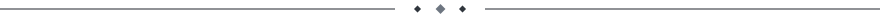
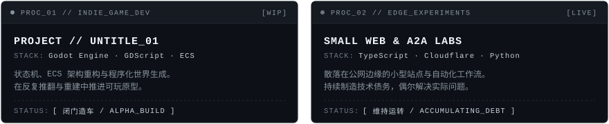

<div align="center">



<br><br>


</div>

<br>



### `01 / MANIFESTO`

> 前应试教育得势者、小网站运营、某 985 在校大学生。  
> 独立游戏制作中，人生仍处于公开测试阶段。

<table width="100%">
<tr>
<td width="50%" valign="top">

**`IDENTITY`**

- 前应试教育得势者
- 某 985 在校大学生
- 小网站运营
- 微信公众号炒作撰稿人
- B站 20w+ 浏览热点视频搬运工

</td>
<td width="50%" valign="top">

**`CURRENT STATE`**

- 人生是低谷
- IMSB
- FL Studio 非订阅用户
- 独立游戏制作中

</td>
</tr>
</table>


### `02 / RUNTIME`

```yaml
user: Zoern
handle: "@himentpear"

runtime:
  environment: "Unstable"
  occupation:  "Undefined"
  education:   "Still compiling"

processes:
  - independent_game_development
  - small_website_operation
  - ai_assisted_programming
  - content_production
  - accumulating_technical_debt

release:
  status: "Under construction"
  eta:    "Before the heat death of the universe"
```


### `03 / WORKBENCH`

<div align="center">
  
</div>


### `04 / TOOLCHAIN`

```text
ENGINE & AUDIO   ::  Godot Engine / FL Studio (Trial)
LANGUAGES        ::  Python / TypeScript / JavaScript / GDScript / HTML & CSS
INFRASTRUCTURE   ::  Cloudflare / Node.js / Git / GitHub
WORKFLOW         ::  VS Code / Figma / AI-Assisted Programming
```

<div align="center">
<br>
<a href="https://github.com/tandpfun/skill-icons">
  
</a>
</div>


### `05 / CONTRIBUTION MATRIX`

<div align="center">

<picture>
  <source
    media="(prefers-color-scheme: dark)"
    srcset="https://raw.githubusercontent.com/himentpear/himentpear/output/github-contribution-grid-snake-dark.svg"
  />
  <source
    media="(prefers-color-scheme: light)"
    srcset="https://raw.githubusercontent.com/himentpear/himentpear/output/github-contribution-grid-snake.svg"
  />
  
</picture>

</div>


<details>
<summary><code>06 / SYSTEM DIAGNOSTICS</code></summary>

<br>

```log
[ OK ] Profile repository initialized
[ OK ] Unrealistic ambition detected
[ OK ] Independent project found
[ OK ] AI interaction frequency exceeds normal range

[WARN] Stable career path not found
[WARN] Sleep schedule may be corrupted
[WARN] Technical debt accumulating
[WARN] Commercial viability remains unverified

[ERR ] Life documentation incomplete
[ERR ] Production environment unstable
[ERR ] Long-term roadmap contains placeholders

> Process continues anyway.
```

</details>

<br>

<div align="center">

*“I'm half sinner, half victim.”*

<br>

`[ 建设中 ]`

</div>
